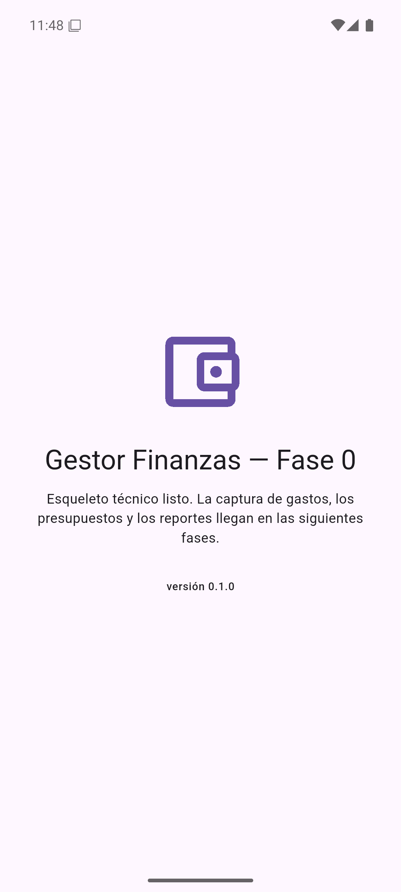

# Gestor Finanzas

App Android de finanzas personales, **local-first** (funciona sin internet), pensada para
uso personal. Consta de **dos componentes**:

1. **La app (Flutter, Android)**: toda la lógica, la base de datos local (SQLite con Drift),
   la interfaz, el OCR de recibos, la transcripción de audio offline, los reportes y los
   respaldos.
2. **El bot de WhatsApp (Node.js)**: un programa aparte que se instala en el mismo teléfono
   (dentro de Termux) con un número secundario. Recibe tus mensajes de texto, audio y fotos,
   los pasa a la app por HTTP local, y envía los mensajes que la app le pide (por ejemplo, los
   reportes diarios). Se conecta con Baileys, sin la API oficial de Meta.

> **Estado actual: Fase 0 — fundación.** Hay esqueleto que compila y arranca en el emulador,
> documentación completa y repositorio Git. **Todavía no hay funcionalidades de finanzas.**

---

## 1. Estructura del repositorio

```
App finanzas/                  ← raíz del repo
├── app/                       ← aplicación Flutter (APK)
│   ├── lib/
│   │   ├── core/              ← configuración, rutas (go_router), tema
│   │   ├── data/              ← Drift/SQLite, repositorios, cliente HTTP (Fase 1+)
│   │   ├── domain/            ← entidades y casos de uso (Fase 1+)
│   │   ├── features/          ← pantallas: bienvenida, cuentas, transacciones, presupuestos,
│   │   │                        deudas, metas, reportes, captura, ajustes
│   │   ├── services/          ← OCR, audio, puente WhatsApp, respaldo, notificaciones, tasas
│   │   └── main.dart
│   ├── android/
│   ├── test/
│   └── pubspec.yaml
├── whatsapp_bot/              ← bot Node.js (esqueleto, Fase 2 lo implementa)
│   ├── index.js
│   ├── package.json
│   └── README.md
├── docs/
│   ├── ARCHITECTURE.md        ← cómo se conectan app y bot
│   ├── API_CONTRACT.md        ← endpoints HTTP entre app y bot
│   ├── DATA_MODEL.md          ← entidades y campos
│   ├── PHASES.md              ← plan de 6 fases
│   └── DECISIONS.md           ← decisiones cerradas (y sus motivos)
└── README.md                  ← este archivo
```

---

## 2. Qué está instalado en este equipo (Windows)

Todo se instaló **en el perfil de usuario** (`C:\Users\PC\...`) para no depender de permisos
de administrador. Las variables de entorno ya están guardadas en el usuario.

| Herramienta | Versión | Ubicación |
|---|---|---|
| Flutter SDK | 3.50.1 stable (Dart 3.14.0) | `C:\Users\PC\flutter` |
| JDK (Temurin) | 21.0.13.1 LTS | `C:\Users\PC\jdks\jdk-21.0.13.1+2` |
| Android SDK | plataforma 36 · build-tools 36.0.0 · platform-tools 37.0.3 · NDK 28.2.13676358 | `C:\Users\PC\Android\Sdk` |
| Emulador Android | 37.3.10 + imagen Google APIs API 36 | `C:\Users\PC\Android\Sdk\emulator` |
| Node.js | 24.21.0 | `C:\Program Files\nodejs` |
| Git | 2.56.1 (portable) | `C:\Users\PC\git` |
| Android Studio | **no instalado** (decisión del dueño: no es necesario) | — |

> Si abres una terminal nueva y `flutter` no aparece, cierra y vuelve a abrir la terminal
> (las variables de entorno nuevas se cargan al iniciar la sesión).
> Para esta sesión de trabajo hay un archivo auxiliar: `C:\Users\PC\gestor_env.ps1`.

### Diagnóstico

```powershell
flutter doctor
```

Resultado esperado en la Fase 0: **"No issues found!"**.

---

## 3. Emulador Android

Ya está creado el dispositivo virtual **`gestor_finanzas_api36`**:
Pixel 7, Android 16 (API 36), imagen **Google APIs**, 4 GB de RAM, 10 GB de datos + 2 GB de SD,
aceleración por **WHPX**.

### Arrancarlo desde línea de comandos

```powershell
# Opción 1: con Flutter
flutter emulators
flutter emulators --launch gestor_finanzas_api36

# Opción 2: directo con el emulador
& "$env:LOCALAPPDATA\Android\Sdk\emulator\emulator.exe" -avd gestor_finanzas_api36
```

Para comprobar que está encendido:

```powershell
adb devices
# debe aparecer: emulator-5554   device
```

---

## 4. Levantar la app en el emulador

```powershell
cd app
flutter pub get
flutter run -d emulator-5554
```

Deberías ver esta pantalla (captura real tomada del emulador):



Si hay más de un dispositivo conectado, `flutter devices` te dice el id exacto.

### Comprobar que todo sigue sano

```powershell
cd app
flutter analyze     # "No issues found!"
flutter test        # "All tests passed!"
```

---

## 5. El bot de WhatsApp (por ahora, solo esqueleto)

En la Fase 0 el bot **no** se conecta a WhatsApp ni instala Baileys. Solo imprime un mensaje:

```powershell
cd whatsapp_bot
node index.js
# → Bot Gestor Finanzas — pendiente Fase 2
```

La instalación real en **Termux** (teléfono Android, número secundario) se hace en la
**Fase 5**. El esqueleto y los pasos provisionales están en
[`whatsapp_bot/README.md`](whatsapp_bot/README.md).

---

## 6. Documentación

| Documento | Para qué sirve |
|---|---|
| [docs/ARCHITECTURE.md](docs/ARCHITECTURE.md) | Diagrama de los dos componentes, qué vive dónde y cómo se comunican |
| [docs/API_CONTRACT.md](docs/API_CONTRACT.md) | Contrato HTTP entre app y bot, con ejemplos |
| [docs/DATA_MODEL.md](docs/DATA_MODEL.md) | Entidades, campos, reglas e índices |
| [docs/PHASES.md](docs/PHASES.md) | Plan completo de las 6 fases |
| [docs/DECISIONS.md](docs/DECISIONS.md) | Decisiones cerradas y por qué se tomaron |

Orden recomendado de lectura: **README → PHASES → ARCHITECTURE → DATA_MODEL → API_CONTRACT →
DECISIONS**.

---

## 7. Plan de fases (resumen)

| Fase | Qué se construye | Estado |
|---|---|---|
| **0** | Fundación: entorno, docs, esqueleto en emulador, bot esqueleto, Git | ✅ **actual** |
| **1** | MVP local: cuentas, categorías/subcategorías/etiquetas, transacciones manuales, dashboard con saldos | — |
| **2** | Captura: OCR de recibos, audio offline en español, texto, integración con bot WhatsApp (modo mock en emulador) | — |
| **3** | Presupuestos, deudas con personas y créditos, metas con aportes/rendimientos/retiros, recurrentes con notificaciones | — |
| **4** | Reportes con gráficas, PDF, reportes diarios 3×/día por WhatsApp, conversión diaria de monedas, respaldo/restauración en Google Drive | — |
| **5** | Endurecimiento, pruebas en teléfono real, APK final, guía de instalación del bot en Termux | — |

Detalle completo en [docs/PHASES.md](docs/PHASES.md).

---

## 8. Decisiones importantes que ya están cerradas

- **Datos 100 % locales** en SQLite. La app funciona sin internet salvo respaldos, tasas de
  cambio y el bot.
- **Sin cifrado de datos y sin ocultar montos**: decisión explícita del dueño. El respaldo en
  Google Drive también va sin cifrar, en archivos legibles.
- **Dinero en centavos** (enteros), nunca decimales flotantes. Moneda base **COP**, con
  conversión diaria para otras monedas.
- **Bot con Baileys en Termux**, número secundario, sin API oficial de Meta (costo $0).
- **Modo mock** del bot para poder probar el flujo dentro del emulador, donde no hay WhatsApp.
- **Emulador desde el día 0**; el APK instalable se genera en la Fase 5.

El detalle y los motivos están en [docs/DECISIONS.md](docs/DECISIONS.md).

---

## 9. Problemas frecuentes

| Síntoma | Qué hacer |
|---|---|
| `flutter: command not found` | Cierra y reabre la terminal, o revisa que `C:\Users\PC\flutter\bin` esté en el PATH |
| El emulador no arranca | Ejecuta `emulator -accel-check`; debe decir "WHPX ... usable" |
| `flutter run` no detecta el emulador | `adb devices` y vuelve a lanzar con `-d emulator-5554` |
| Primera compilación muy lenta | Gradle descarga dependencias la primera vez (varios minutos); las siguientes son rápidas |
| Gradle falla con *"did not install NDK 28.2.13676358"* | Instálalo con el CLI nuevo: `android sdk install "ndk;28.2.13676358"` |
| `flutter doctor` marca licencias de Android | `flutter doctor --android-licenses` y acepta |
| `npm` falla con *"la ejecución de scripts está deshabilitada"* | Usa `node index.js` directamente, o una vez: `Set-ExecutionPolicy -Scope CurrentUser RemoteSigned` |

---

## 10. Lo que **no** existe todavía (a propósito)

- No hay pantallas de cuentas, transacciones, presupuestos, deudas, metas ni reportes.
- No hay base de datos implementada.
- No hay OCR, ni audio, ni biometría, ni respaldo en Drive.
- No está instalado Baileys ni hay conexión a WhatsApp.
- No hay APK de entrega (se genera en la Fase 5).
