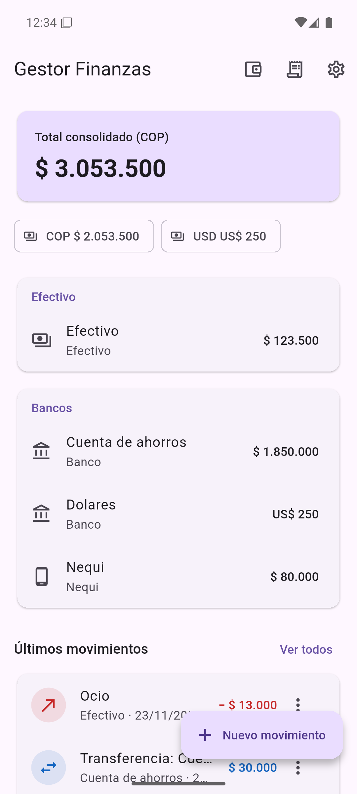

# Gestor Finanzas

App Android de finanzas personales, **local-first** (funciona sin internet), pensada para
uso personal. **Repositorio: <https://github.com/juanmartindiaz/Finanzas_juanmar>**

Consta de **dos componentes**:

1. **La app (Flutter, Android)**: toda la lógica, la base de datos local (SQLite con Drift),
   la interfaz, el OCR de recibos, la transcripción de audio offline, los reportes y los
   respaldos.
2. **El bot de WhatsApp (Node.js)**: un programa aparte que se instalará en el mismo teléfono
   (dentro de Termux) con un número secundario. Recibirá tus mensajes de texto, audio y fotos,
   los pasará a la app por HTTP local, y enviará los mensajes que la app le pida (por ejemplo,
   los reportes diarios). Se conecta con Baileys, sin la API oficial de Meta.

> **Estado actual: Fase 2 parte 2 completada** (bot real con Baileys + bandeja + canal HTTP).
> La app registra cuentas, categorías, etiquetas, ingresos, gastos y transferencias, muestra el
> dashboard, captura por texto con parser en español y recibe capturas por HTTP. El **bot de
> WhatsApp** ya está implementado en `whatsapp_bot/`; falta probarlo en el teléfono real (Termux
> + número secundario). OCR, transcripción y foreground service vienen en los próximos prompts.

---

## 1. Estructura del repositorio

```
App finanzas/                  ← raíz del repo
├── app/                       ← aplicación Flutter (APK)
│   ├── lib/
│   │   ├── core/              ← configuración, rutas (go_router), tema, utilidades
│   │   ├── data/              ← base Drift, repositorios, proveedores Riverpod
│   │   ├── domain/            ← entidades y casos de uso (saldos, tasas, validación)
│   │   ├── features/          ← pantallas: dashboard, cuentas, transacciones, ajustes
│   │   ├── services/          ← OCR, audio, puente WhatsApp… (Fase 2+)
│   │   └── main.dart
│   ├── android/
│   ├── test/                  ← 37 pruebas de dinero, saldos, semilla y multimoneda
│   └── pubspec.yaml
├── whatsapp_bot/              ← bot Node.js (esqueleto; la Fase 2 lo implementa)
├── docs/                      ← documentación del proyecto
│   ├── ARCHITECTURE.md
│   ├── API_CONTRACT.md
│   ├── DATA_MODEL.md
│   ├── PHASES.md
│   ├── DECISIONS.md
│   └── capturas/              ← capturas de pantalla de cada fase
└── README.md                  ← este archivo
```

---

## 2. Qué se puede hacer hoy (Fase 2 parte 1)

| Pantalla | Ruta | Qué hace |
|---|---|---|
| Bandeja de capturas | `/bandeja` | Pendientes/listas arriba, historial abajo; captura manual de texto y badge de pendientes en el dashboard |
| Revisión de captura | `/bandeja/:id` | Reutiliza el formulario de transacción: confirmar crea la transacción real; descartar no crea nada |
| Simulador de bot | `/ajustes/simulador` | Envía texto, imagen o audio al servidor local por HTTP real (como el bot) |
| Canal bot | `/ajustes/canal-bot` | Token (ver/copiar/regenerar), puerto, MOCK_BOT y estado del servidor |
|---|---|---|
| Dashboard | `/` | Total consolidado en la moneda base, subtotales por moneda, saldos agrupados por tipo (Efectivo, Bancos, Tarjetas, Ahorro, Inversión) y últimas 10 transacciones. Botón **+** para nuevo movimiento |
| Cuentas | `/cuentas` | Crear, editar, activar/desactivar y borrar cuentas de los 7 tipos. Borrar una cuenta con movimientos ofrece desactivarla |
| Transacciones | `/transacciones` | Listado con filtros por tipo, cuenta, categoría, etiqueta, rango de fechas y búsqueda en la nota |
| Nuevo/editar movimiento | `/transacciones/nueva` · `/transacciones/:id/editar` | Ingreso, gasto o transferencia (con monto de origen y de destino para monedas distintas), etiquetas, fecha y hora, nota |
| Ajustes | `/ajustes` | Moneda base y tasas manuales, categorías y subcategorías, etiquetas, cuentas |
| Monedas y tasas | `/ajustes/monedas` | Cambiar la moneda base y registrar tasas manuales por par (por ejemplo, 1 USD = 4.000 COP) |
| Categorías | `/ajustes/categorias` | Editar, archivar o borrar categorías y subcategorías; con movimientos se archivan |
| Etiquetas | `/ajustes/etiquetas` | Crear, editar y borrar etiquetas |

### Reglas ya implementadas

- **Saldo calculado**, nunca guardado: saldo inicial + ingresos − gastos ± transferencias.
- **Transferencias** no son ingreso ni gasto: no alteran los totales, solo mueven saldo.
- **Borrar/editar** un movimiento recalcula los saldos al instante.
- **Multimoneda**: cada cuenta conserva su moneda; el consolidado usa la tasa manual más
  reciente (nunca una futura). Si falta la tasa, la cuenta se marca como "sin convertir".
- **Semilla** de 10 categorías de gasto + 6 de ingreso (con subcategorías) que corre una sola
  vez; editarlas o borrarlas no las reinserta.
- **Borrado lógico**: cuentas/categorías/etiquetas se ocultan, no se destruyen; con
  movimientos asociados se archivan en lugar de borrarse.
- **Formato COP**: `$ 1.234.567` (punto de miles); si hay centavos, `$ 18.500,50`.
- **Sin internet**: todo es local (SQLite en el teléfono). Sin cifrado, por decisión del dueño.

---

## 3. Entorno de desarrollo (Windows)

Todo se instaló **en el perfil de usuario** (`C:\Users\PC\...`) para no depender de permisos
de administrador. Las variables de entorno ya están guardadas en el usuario.

| Herramienta | Versión | Ubicación |
|---|---|---|
| Flutter SDK | 3.50.1 stable (Dart 3.14.0) | `C:\Users\PC\flutter` |
| JDK (Temurin) | 21.0.13.1 LTS | `C:\Users\PC\jdks\jdk-21.0.13.1+2` |
| Android SDK | plataforma 36 · build-tools 36.0.0 · platform-tools 37.0.3 · NDK 28.2 | `C:\Users\PC\Android\Sdk` |
| Emulador Android | 37.3.10 + imagen Google APIs API 36 | `C:\Users\PC\Android\Sdk\emulator` |
| Node.js | 24.21.0 | `C:\Program Files\nodejs` |
| Git | 2.56.1 (portable) | `C:\Users\PC\git` |
| Android Studio | **no instalado** (decisión del dueño) | — |

> Si abres una terminal nueva y `flutter` no aparece, cierra y vuelve a abrir la terminal.
> Para esta sesión de trabajo hay un archivo auxiliar: `C:\Users\PC\gestor_env.ps1`.

### Diagnóstico

```powershell
flutter doctor
```

Resultado esperado: **"No issues found!"**.

---

## 4. Emulador Android

Dispositivo virtual **`gestor_finanzas_api36`**: Pixel 7, Android 16 (API 36), imagen
**Google APIs**, 4 GB de RAM, 10 GB de datos + 2 GB de SD, aceleración por **WHPX**.

```powershell
# Opción 1: con Flutter
flutter emulators
flutter emulators --launch gestor_finanzas_api36

# Opción 2: directo con el emulador
& "$env:LOCALAPPDATA\Android\Sdk\emulator\emulator.exe" -avd gestor_finanzas_api36
```

Comprobación:

```powershell
adb devices
# debe aparecer: emulator-5554   device
```

---

## 5. Levantar la app en el emulador

```powershell
cd app
flutter pub get
flutter run -d emulator-5554
```

Captura real de la Fase 1:



### Comprobar que todo sigue sano

```powershell
cd app
flutter analyze     # "No issues found!"
flutter test        # "All tests passed!" (68 pruebas de la app)

cd ../whatsapp_bot
npm test            # 23 pruebas del bot con transporte falso
```

### Probar los flujos principales (5 minutos)

1. **Crear una cuenta**: Dashboard → icono de cuentas → **Nueva cuenta**. Elige tipo, moneda
   y saldo inicial. Al guardar, la cuenta aparece con su saldo.
2. **Registrar un gasto**: botón **+** (o Transacciones → **Nuevo movimiento**). Monto
   `18.500`, cuenta, categoría (*Alimentación*) y subcategoría (*Supermercado*). Guarda.
   El dashboard descuenta el monto del saldo y del total.
3. **Registrar un ingreso**: mismo formulario, pestaña **Ingreso**, categoría *Salario*.
4. **Transferir entre cuentas**: pestaña **Transferencia**, cuenta de origen y de destino.
   El total consolidado **no cambia**; los saldos de ambas cuentas sí.
5. **Borrar un movimiento**: en el listado, menú ⋮ → *Borrar movimiento*. El saldo se
   recalcula solo.
6. **Filtros**: en Transacciones, filtra por tipo/cuenta/categoría/etiqueta o escribe en la
   búsqueda de la nota.
7. **Borrar una cuenta con movimientos**: menú ⋮ → *Borrar*. Ofrece **desactivarla**.
8. **Semilla**: en Ajustes → Categorías están las 16 categorías iniciales; puedes editarlas,
   archivarlas o borrarlas.
9. **Multimoneda**: crea una cuenta en USD con saldo; en Ajustes → Monedas registra la tasa
   `1 USD = 4.000 COP` y verás el total consolidado actualizado.

### Probar la captura (Fase 2 parte 1)

1. **Captura manual por texto**: Dashboard → icono de bandeja → *Capturar texto* → escribe
   `gasté 18.500 en mercado` → *Procesar*. Se abre la revisión con la propuesta; ajusta y
   **Confirmar**. La transacción se crea y la captura queda *Confirmado*.
2. **Simulador de bot**: Ajustes → *Canal bot* (verifica que MOCK_BOT esté activo y el servidor
   escuchando) → *Abrir simulador de bot* → envía un texto, una imagen y un audio. Cada envío
   usa HTTP real al `127.0.0.1:8787` y aterriza en la bandeja.
3. **Health check**: `curl http://127.0.0.1:8787/api/salud` (en el teléfono/emulador, sin token).
4. **Offline**: activa el modo avión del emulador y repite el paso 2; el canal de loopback sigue
   funcionando, sin internet.
5. **Token y límites**: sin cabecera `X-Bot-Token` el servidor responde `401`; un archivo de más
   de 8 MB responde `413`; reenviar el mismo `message_id` responde `409` y no duplica.

---

## 6. Base de datos

- Archivo: `gestor_finanzas.sqlite` en la carpeta privada de la app (`app_flutter/`).
- Esquema: **versión 1** (Drift) con `cuenta`, `categoria`, `subcategoria`, `etiqueta`,
  `transaccion`, `transaccion_etiqueta`, `tasa_cambio`, `configuracion` y `recibo` (estructura).
- Llaves foráneas activas y **índices únicos parciales** para reutilizar nombres después de
  un borrado lógico.
- Los saldos **no** se guardan: se calculan desde los movimientos.
- Detalle completo en [docs/DATA_MODEL.md](docs/DATA_MODEL.md).

---

## 7. El bot de WhatsApp (Fase 2 parte 2)

El bot real está en `whatsapp_bot/`: Node.js + Baileys, corre en **Termux** con un número
secundario, guarda una cola persistente y entrega a la app por HTTP local. Responde por WhatsApp
(texto/audio/foto), ignora grupos y números no autorizados, y reintenta si la app está cerrada.

- Guía completa de instalación y operación en Termux:
  [`whatsapp_bot/README.md`](whatsapp_bot/README.md).
- Configuración: copia `config.example.json` a `config.json`, pega el token de Ajustes →
  Canal bot y escribe tu número autorizado.
- Pruebas del bot en el PC (sin WhatsApp): `cd whatsapp_bot && npm install && npm test`
  (23 pruebas con transporte falso).
- `config.json`, `auth/`, `cola/` y `logs/` están en `.gitignore`: no se suben al repositorio.

**Pendiente de validar en tu teléfono:** el QR y la conexión real con WhatsApp (no se pueden
probar en el emulador). Sigue el protocolo de `whatsapp_bot/README.md` §14.

---

## 8. Documentación

| Documento | Para qué sirve |
|---|---|
| [docs/ARCHITECTURE.md](docs/ARCHITECTURE.md) | Los dos componentes, qué vive dónde y cómo se comunican |
| [docs/API_CONTRACT.md](docs/API_CONTRACT.md) | Contrato HTTP entre app y bot (Fase 2) |
| [docs/DATA_MODEL.md](docs/DATA_MODEL.md) | Entidades, campos, reglas, índices y cambios de la Fase 1 |
| [docs/PHASES.md](docs/PHASES.md) | Plan completo de las 6 fases |
| [docs/DECISIONS.md](docs/DECISIONS.md) | Decisiones cerradas y por qué se tomaron |

Orden recomendado: **README → PHASES → ARCHITECTURE → DATA_MODEL → API_CONTRACT → DECISIONS**.

Capturas de la Fase 1 en [`docs/capturas/`](docs/capturas/): dashboard, transacciones,
formulario, ajustes, categorías y monedas.

---

## 9. Plan de fases (resumen)

| Fase | Qué se construye | Estado |
|---|---|---|
| **0** | Fundación | ✅ completada |
| **1** | MVP local | ✅ completada |
| **2** | Captura: bandeja + canal HTTP + **bot de WhatsApp con Baileys**; OCR, audio y foreground service pendientes | ✅ partes 1 y 2 / ⏳ resto |
| **3** | Presupuestos, deudas con personas y créditos, metas, recurrentes con notificaciones | — |
| **4** | Reportes con gráficas, PDF, reportes diarios por WhatsApp, conversión diaria de monedas, respaldo/restauración en Google Drive | — |
| **5** | Endurecimiento, pruebas en teléfono real, APK final, guía del bot en Termux, PIN/biometría | — |

Detalle completo en [docs/PHASES.md](docs/PHASES.md).

---

## 10. Decisiones importantes que ya están cerradas

- **Datos 100 % locales** en SQLite. Sin internet salvo respaldos, tasas y bot (fases futuras).
- **Sin cifrado de datos y sin ocultar montos**: decisión explícita del dueño.
- **Dinero en centavos** (enteros), nunca decimales flotantes. Moneda base **COP**.
- **Tasas manuales** en la Fase 1; la conversión automática diaria llega en la Fase 4.
- **Bot con Baileys en Termux**, número secundario, sin API oficial (Fase 2 + Fase 5).
- **Emulador desde el día 0**; el APK instalable se genera en la Fase 5.
- **Sin Android Studio**: SDK por línea de comandos (decisión del dueño).

El detalle y los motivos están en [docs/DECISIONS.md](docs/DECISIONS.md).

---

## 11. Problemas frecuentes

| Síntoma | Qué hacer |
|---|---|
| `flutter: command not found` | Cierra y reabre la terminal, o revisa que `C:\Users\PC\flutter\bin` esté en el PATH |
| El emulador no arranca | `emulator -accel-check`; debe decir "WHPX ... usable" |
| `flutter run` no detecta el emulador | `adb devices` y reintenta con `-d emulator-5554` |
| Primera compilación muy lenta | Gradle descarga dependencias la primera vez (varios minutos) |
| Gradle falla con *"did not install NDK 28.2.13676358"* | `android sdk install "ndk;28.2.13676358"` |
| `npm` falla con "la ejecución de scripts está deshabilitada" | Usa `node index.js`, o una vez: `Set-ExecutionPolicy -Scope CurrentUser RemoteSigned` |
| Quiero empezar de cero con la base | Desinstala la app del emulador y vuelve a ejecutar `flutter run` |

---

## 12. Lo que **no** existe todavía (a propósito)

- OCR de recibos y transcripción de audio (fases 2.4/2.5); por ahora solo se guardan.
- Servicio en primer plano: el servidor se apaga con la app (fase 2.6).
- Cola de salida y reportes automáticos por WhatsApp (Fase 4).
- Presupuestos, deudas, créditos, metas y recurrentes (Fase 3).
- Reportes, PDF, conversión automática de monedas y respaldo en Drive (Fase 4).
- PIN/biometría y APK firmado de entrega (Fase 5).
